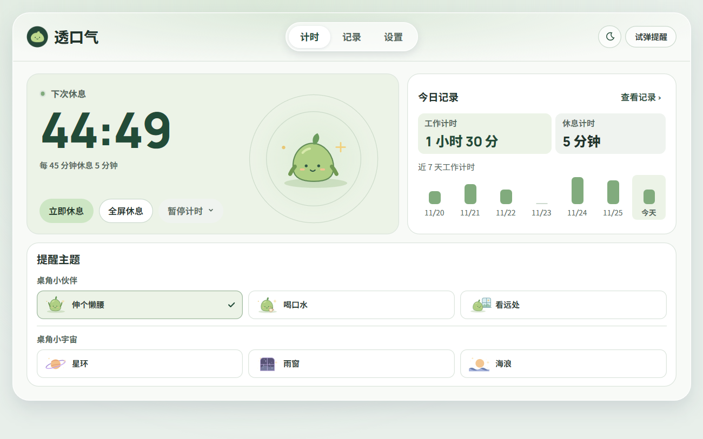
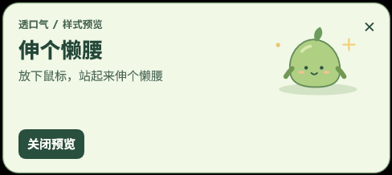
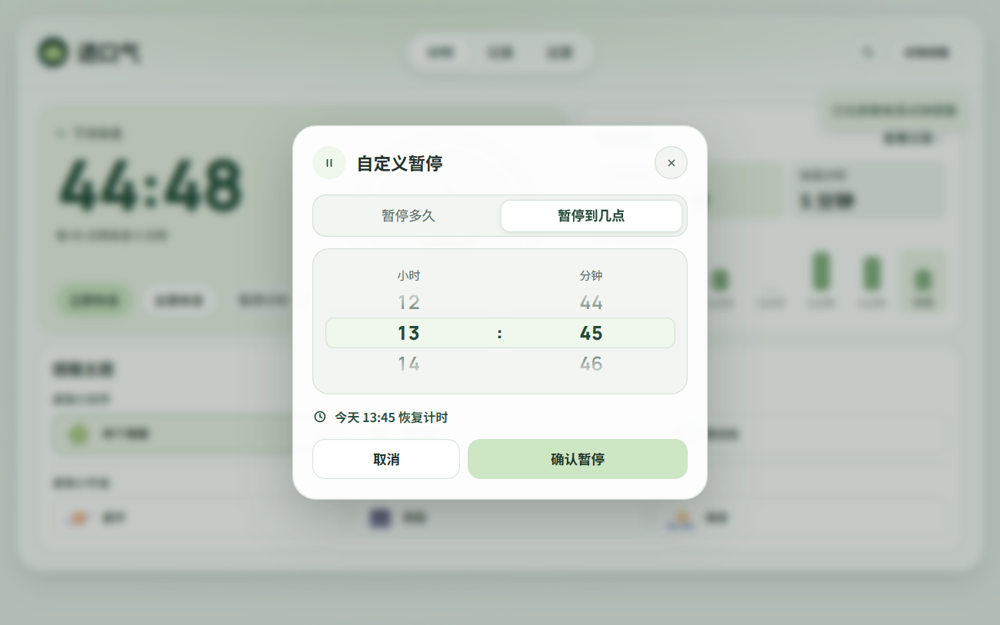

# 透口气 🌿

给一忙起来就忘了起身的你，一个桌面休息提醒

**Windows x64 · v0.6.7 原生试用版**

## 下载

### [下载 Windows 便携版（约 27.6 MB）](https://github.com/pink-mimi/rest-reminder-releases/releases/download/v0.6.7/RestReminder-0.6.7-Native-x64.zip)

[本次版本说明与附件](https://github.com/pink-mimi/rest-reminder-releases/releases/tag/v0.6.7) · [使用说明](INSTALL.md) · [反馈问题](https://github.com/pink-mimi/rest-reminder-releases/issues/new/choose)

适用于 64 位 Intel / AMD Windows 电脑，解压后约 71.5 MB。

试用包尚未正式签名，Windows 可能提示未知发布者或拦截。请从本仓库的 Release 附件下载，文件校验值见 [SHA256SUMS.txt](SHA256SUMS.txt)。

## 它怎么提醒你

默认工作 **45 分钟**、休息 **5 分钟**，两个时间都能调整

到点后，屏幕一角出现一张静音卡片，键盘输入继续留在正在工作的窗口。你可以开始休息、5 分钟后再提醒，或者跳过本次

休息结束会轻提示一次，并自动开始下一轮。关闭设置窗口后仍在后台运行；从托盘可以查看剩余时间、开始休息、暂停或退出

想休息得完整一点，可以主动进入全屏休息，按 Esc 返回角落后倒计时继续。到点提醒默认不会进入全屏

## 可以按自己的习惯设置

- 工作间隔、休息时长，以及忙时未处理提醒的方式
- 暂停 30 分钟、1 小时，或自定义时长和恢复时间。恢复后接着原倒计时走
- 查看今日工作与休息计时、近 7 天趋势及每天的时段。暂停会单独标记
- 桌角小伙伴和桌角小宇宙，两套主题共六个场景
- 明亮、暗黑或跟随系统外观，支持减少动态效果
- 可选开机启动，与启动后自动开始计时分别设置
- 本机保存设置，未保存的休息规则以草稿保留

## 开始使用

1. 下载 `RestReminder-0.6.7-Native-x64.zip` 并完整解压。
2. 打开解压目录中的 `RestReminderNativeLauncher.exe`。
3. 点击「开始提醒」，开始第一轮工作计时。

默认不会一打开就开始计时，可在「设置」的「启动」中开启「启动时自动开始」

## 技术栈

界面使用 NSH 0.7.1 和 TypeScript / TSX，运行在 QuickJS 上。Windows 端通过 Win32 原生渲染，由 C# / .NET Framework 助手处理开机启动、锁屏和睡眠唤醒。

## 试用说明

- 当前为试用版，建议先体验并反馈问题
- 不检测坐姿，不判断你是否真的坐着，也不识别会议或录屏；需要安静时可手动暂停
- 无需注册，应用功能不依赖网络，设置保存在本机
- 当前没有应用内自动更新，新版会发布在[版本列表](https://github.com/pink-mimi/rest-reminder-releases/releases)
- 本仓库用于发布便携包、使用说明和问题反馈，源码仓库为私有

[查看隐私说明](PRIVACY.md) · [查看更新记录](CHANGELOG.md) · [如何反馈](FEEDBACK.md)
